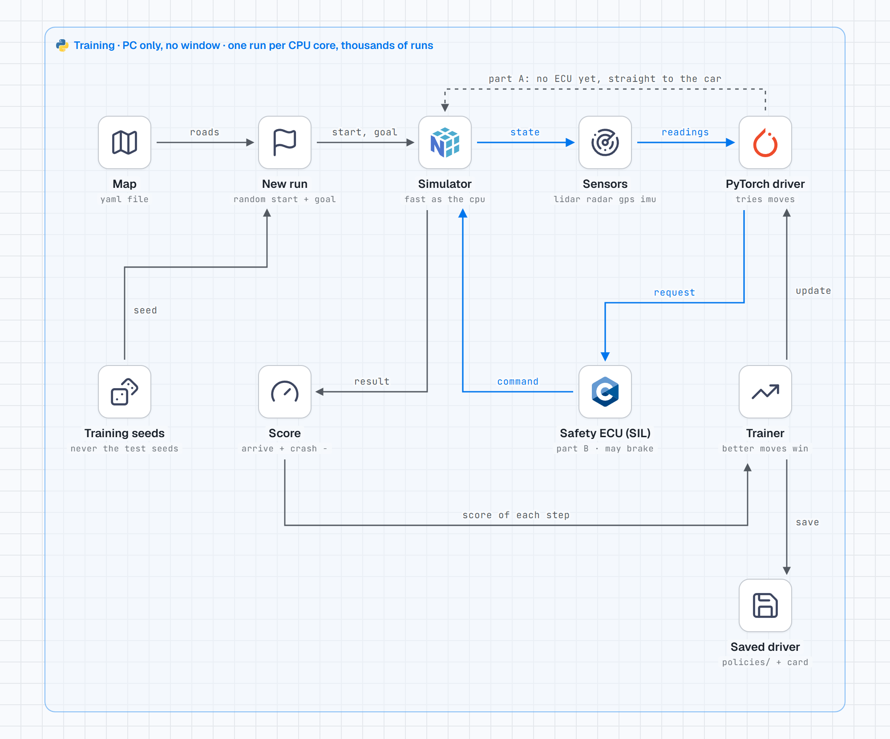
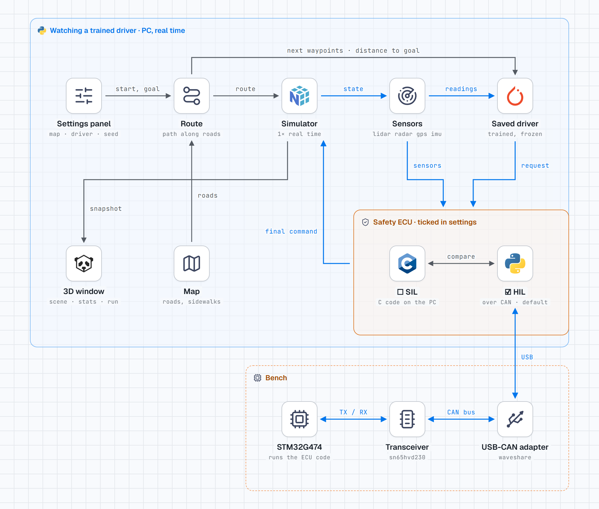

# auto-safety-hil-ecu

A learning project: a car that learns to drive itself in a simulator, and later a real safety computer that watches every move.

It is built in two parts.

**Part 1: the simulator and the learning driver (PC only)**
- **A simple world:** one map with a road, sidewalks, buildings, obstacles and pedestrians who walk and cross. The map is stored as data, so new maps can be made later.
- **The car** has gas, brake and steering, and the stats a self-driving car needs about itself: speed, acceleration, steering angle, heading, position and more.
- **Its sensors:** a 360° lidar, a front radar, GPS, an IMU and wheel speeds. More can be added later.
- **The driver is a PyTorch model.** It reads the stats and the sensors and decides gas, brake and steering. Each attempt to reach a destination is a run: arriving scores well, hitting anything scores badly, and the model learns from many runs.
- **Training runs without a window by default,** much faster than real time. A 3D window can be turned on to watch a run: the car on the map, every stat and sensor value, and which run it is.

**Part 2: the safety computer (an STM32 on a real CAN bus)**
- The driver's commands no longer go straight to the car. They go over a car network to an STM32 microcontroller, the safety computer.
- On its own fixed cycle, the STM32 checks the commands and the sensor data. A good command passes through; when the car gets too close, it brakes on its own. It reports every time it steps in, and each time counts against the run's score, so the driver learns to need it less.

## How training works

<picture>
  <source media="(prefers-color-scheme: dark)" srcset="docs/training-dark.png">
  
</picture>

Training runs on the PC only, with no window, one run per CPU core and thousands of runs. Each run starts at a random spot with a random goal. The driver tries moves, the score says how each step went (arriving is good, crashing is bad), and the trainer makes the better moves more likely. In part 2 every move first passes the safety ECU, here its C code running on the PC (SIL), so training stays fast.

## How a trained driver runs

<picture>
  <source media="(prefers-color-scheme: dark)" srcset="docs/running-dark.png">
  
</picture>

In the 3D window you pick the map, the driver, the seed and the safety ECU before a run. The route follows the roads from start to goal, and the driver steers toward its next waypoints. The safety ECU is the real STM32 by default (HIL). Tick SIL to use the PC copy instead, or tick both to compare their decisions step by step. The car obeys only the ECU's final command, and every time the ECU steps in, the run scores lower.

> **Not a real safety system.** This is for learning only. It borrows ideas from car safety engineering, but claims no safety standard, and it controls only a simulated car.

## License
MIT, see [LICENSE](LICENSE). Third-party code keeps its own license.
