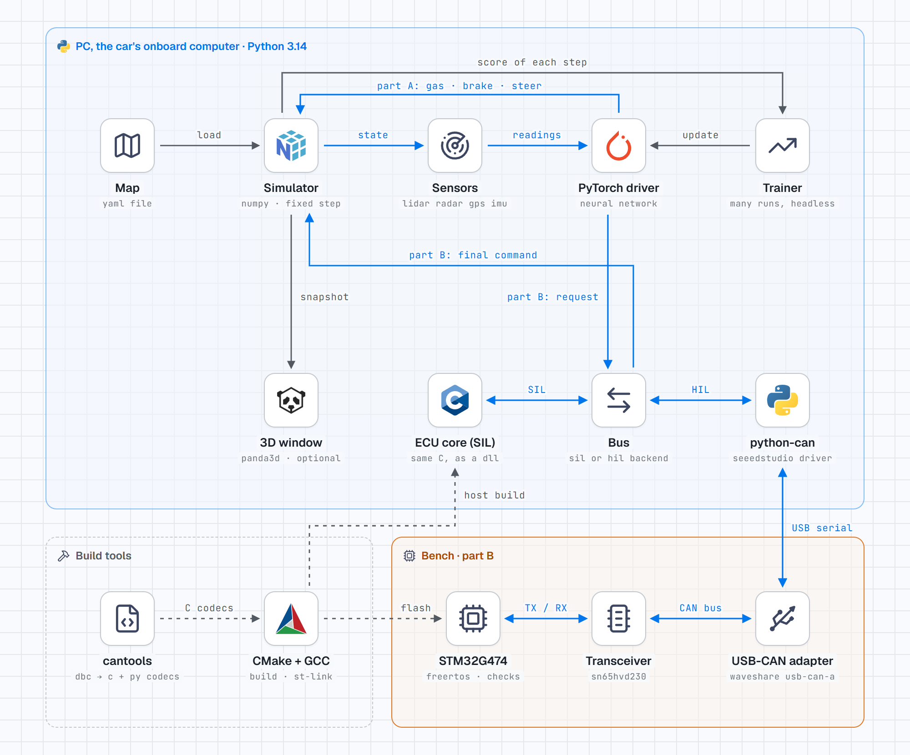

# auto-safety-hil-ecu

A learning project: a car that learns to drive itself in a simulator, and later a real safety computer that watches every move.

It is built in two parts.

**Part 1: the simulator and the learning driver (PC only)**
- **A simple world:** one map with a road, sidewalks, buildings, obstacles and pedestrians who walk and cross. The map is stored as data, so new maps can be made later.
- **The car** has gas, brake and steering, and the stats a self-driving car needs about itself: speed, acceleration, steering angle, heading, position and more.
- **Its sensors:** a 360° lidar, a front radar, GPS, an IMU and wheel speeds. More can be added later.
- **The driver is a PyTorch model.** It reads the stats and the sensors and decides gas, brake and steering. Each attempt to reach a destination is a run: arriving scores well, hitting anything scores badly, and the model learns from many runs.
- **Training runs without a window by default,** much faster than real time. A 3D window can be turned on to watch a run: the car on the map, every stat and sensor value, and which run it is.

**Part 2: the safety computer (an STM32 on a real CAN bus)**
- The driver's commands no longer go straight to the car. They go over a car network to an STM32 microcontroller, the safety computer.
- On its own fixed cycle, the STM32 checks the commands and the sensor data. A good command passes through; when the car gets too close, it brakes on its own. It reports every time it steps in, and each time counts against the run's score, so the driver learns to need it less.

## How it fits together

<picture>
  <source media="(prefers-color-scheme: dark)" srcset="docs/architecture-dark.png">
  
</picture>

Blue: the driving loop (part 1 straight back to the simulator, part 2 through the ECU). Grey: the map, the score and the 3D view. Dashed: build time.

In part 2 the STM32 checks every message (intact, new, on time, sensible), then allows the command, limits it, or brakes on its own.

The driver on the PC only asks. The STM32 always decides what the car actually does, and every time it steps in, the run scores lower.

> **Not a real safety system.** This is for learning only. It borrows ideas from car safety engineering, but claims no safety standard, and it controls only a simulated car.

## License
MIT, see [LICENSE](LICENSE). Third-party code keeps its own license.
