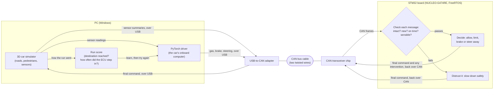

# auto-safety-hil-ecu

A learning project: a car that learns to drive itself in a 3D simulator, with a real safety computer watching every move.

- **The driver** is a PyTorch model on the PC, which plays the car's onboard computer. It drives like a person, with gas, brake and steering, and sees what a self-driving car's sensors see: lidar, cameras, radar, microphones, GPS, an IMU and wheel speeds.
- **The safety computer** is an STM32 microcontroller on a real car network (CAN bus). It checks every command and steps in when it must: it brakes, or steers away when the car gets too close. It reports every time it does.
- **Each attempt is a run** toward a destination, on a course or a street with pedestrians. Reaching the destination scores well; every time the safety computer had to step in counts against the run. The model learns from the scores and tries different moves next time.
- **Everything is in 3D,** so each run can be watched as it happens, or replayed.

## How data flows

The driver on the PC only asks. The STM32 always decides what the car actually does, and every time it steps in, the run scores lower.

> **Not a real safety system.** This is for learning only. It borrows ideas from car safety engineering, but claims no safety standard, and it controls only a simulated car.

## License
MIT, see [LICENSE](LICENSE). Third-party code keeps its own license.
